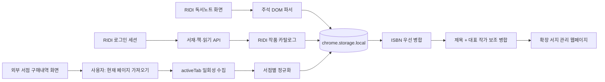

# 로컬 서지 관리와 서점 통합 구조

기준 시각은 2026-10-24 20:52 KST다.

## 구현 범위

| 기능 | 상태 | 근거와 경계 |
|---|---|---|
| RIDI 전체 서지 | 구현 | 서재 API 결과를 작품 단위 카탈로그로 정규화 |
| 제목·작가·출판사·메모 검색 | 구현 | 확장 자체 웹페이지에서 로컬 필터 |
| 소장·일부 소장·미구매 필터 | 구현 | RIDI 소장과 추천 결과 기준 |
| 아직 안 읽음·읽는 중·보유분 완독·발매분 완독·완독 | 구현 | RIDI가 제공한 마지막으로 연 권 기준 |
| 구매 작가의 다른 작품 | 구현 | 분석한 상위 구매 작가 검색 결과에서 소장 작품 제외 |
| 로컬 작품 메모 | 구현 | `ridi_book_annotations`에만 저장 |
| RIDI 독서노트 | 구현 | 방문한 `/reading-note/*` DOM의 개별 주석을 중복 병합 |
| 알라딘·YES24·교보문고·영풍문고 구매 기록 | 베타 구현 | 구매내역으로 판별된 현재 화면의 상품 링크만 사용자 동작으로 수집 |
| 전자책·종이책 통합 | 구현 | ISBN 우선, 제목과 대표 작가 보조 키로 작품 병합 |
| 외부 서점 자동 페이지네이션 | 미구현 | 사이트별 비공개 화면 계약과 과도한 자동 탐색을 피함 |
| 외부 서점 주문 취소·환불 반영 | 미구현 | 현재 보이는 구매 행만 수집하므로 별도 상태 파서 필요 |

## 데이터 흐름

확장은 외부 서점 로그인 비밀번호와 쿠키를 읽거나 저장하지 않는다.

외부 서점 수집 권한은 사용자가 확장 팝업을 연 현재 탭에 `activeTab`으로 한 번 부여되며 지속 호스트 권한은 선언하지 않는다.

일반 상품·추천 페이지는 구매 페이지로 판별되지 않으면 수집을 거부한다.

## 로컬 키

| 저장 키 | 내용 | 외부 전송 |
|---|---|---|
| `ridi_analysis` | 추천 결과와 분석 시각 | 없음 |
| `ridi_page_index` | RIDI 배지와 전체 서지용 카탈로그 | 없음 |
| `ridi_book_annotations` | 사용자가 작성한 작품 메모 | 없음 |
| `ridi_reading_notes` | 방문한 RIDI 독서노트 화면에서 확인한 주석 | 없음 |
| `bookstore_libraries` | 서점별 정규화 구매 기록 | 없음 |

## 병합 규칙과 반례

ISBN-13이 같으면 동일 판본으로 우선 병합한다.

RIDI처럼 ISBN이 없는 데이터는 권수·전자책 표기를 제거한 제목과 대표 작가를 보조 키로 사용한다.

동명 작품·동명이인, 합본·개정판, 작가 표기 순서 차이는 오병합 또는 분리를 만들 수 있다.

ISBN이 다른 전자책과 종이책도 제목·대표 작가가 같으면 작품 단위로 묶지만 구매 원본 행은 `purchaseRecords`에 유지한다.

## 독서노트 범위

2026-10-24 로그인 화면에서 독서노트 타임라인의 작품 5개와 개별 주석 링크 10개가 DOM에 노출되는 것을 확인했다.

이 수치는 해당 계정과 시각의 관찰이며 전체 독서노트 API의 존재나 장기 DOM 계약을 의미하지 않는다.

RIDI 공식 도움말에 따르면 형광펜·메모·책갈피는 동기화할 수 있지만 PDF는 독서노트를 지원하지 않고 일부 PC 뷰어 형식은 서버 동기화 대상이 아니다.

- [RIDI 독서노트 사용 방법](https://ridihelp.ridibooks.com/support/solutions/articles/154000207703)
- [작품 삭제 시 독서노트 동기화 여부](https://ridihelp.ridibooks.com/support/solutions/articles/154000207704-%EC%9E%91%ED%92%88-%EC%82%AD%EC%A0%9C-%EC%8B%9C-%EB%8F%85%EC%84%9C%EB%85%B8%ED%8A%B8-%EB%8F%99%EA%B8%B0%ED%99%94-%EC%97%AC%EB%B6%80)

## 검증 경계

정규화·형식 판정·중복 병합·구매 페이지 차단·독서노트 레코드 병합은 단위 테스트로 검증한다.

RIDI 독서노트 DOM은 로그인된 실제 화면에서 구조를 관찰했다.

외부 네 서점의 로그인 구매내역 DOM은 이번 구현 시점에 계정별 실화면 검증을 완료하지 않았으므로 커넥터는 베타로 표시한다.

각 서점 DOM이 변경되면 상품 0개로 끝날 수 있으며, 이 경우 원본 페이지를 변경하지 않고 사용자에게 실패를 표시한다.
