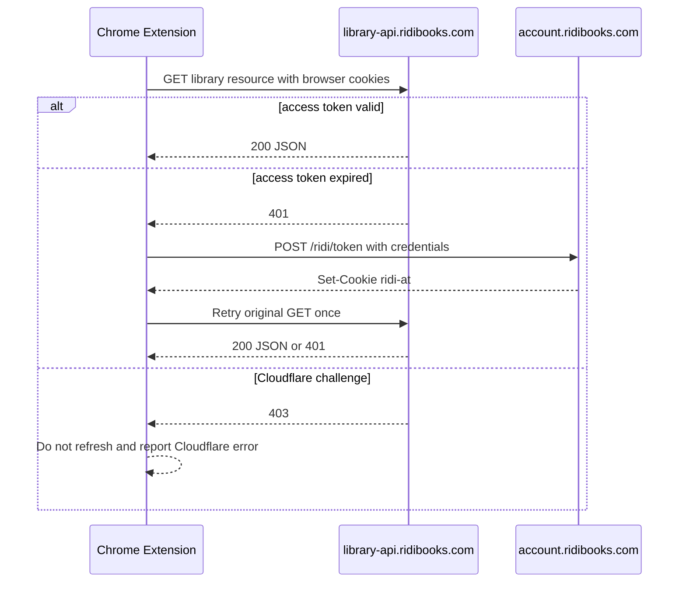

# RIDI 인증 및 라이브러리 API 분석

기준 시각은 2026-10-24 18:29 KST이며, 2026-10-24 18:33 KST의 CDN 응답 헤더를 추가 확인했다.

## 결론

| 항목 | 확인 결과 | 적용 |
|---|---|---|
| 액세스 쿠키 | `ridi-at` 명칭과 JWT 형식은 유지된다. | 기존 타입을 유지하고 JWT 형식을 검증한다. |
| 자동 갱신 | 공식 라이브러리 클라이언트는 API 401 뒤 `POST https://account.ridibooks.com/ridi/token`을 호출하고 원요청을 재시도한다. | 확장에서 단일 실행 갱신과 1회 재시도를 구현했다. |
| 리프레시 쿠키 | 갱신 요청에는 브라우저 쿠키 저장소의 `ridi-rt`가 자동으로 포함된다. | 확장은 값을 애플리케이션 저장소나 응답에 노출하지 않고 `credentials: include`만 사용한다. |
| 라이브러리 API | `/items/main/count/`와 `/items/...` 계열은 현 배포 번들에도 남아 있다. | 기존 라이브러리 경로를 유지한다. |
| Cloudflare | 403은 토큰 만료와 다른 실패이며 쿠키, 브라우저 지문, 접속 IP의 영향을 받을 수 있다. | 개인 서재 분석을 사용자 브라우저의 확장으로 이동한다. |
| 웹 배포 | Vercel 출구 IP는 사용자 브라우저와 달라 사용자 `cf_clearance` 재사용이 실패할 수 있다. | Vercel은 공개 도서 검색과 확장 배포에 사용하고 수동 서재 연결은 고급 기능으로만 유지한다. |

## 확인 근거

1. [RIDI 라이브러리](https://ridibooks.com/library)가 참조한 [메인 번들](https://static.ridicdn.net/library-frontend/p/6daf78/app.7068455b1dd52c5d9d60.js)의 빌드 경로는 `library-frontend/p/6daf78`이었다.
2. 메인 번들의 SHA-256은 `0549f2e2de065c9271bec3cbd8c94291df7f810ea1e913761c04443b9572cf69`이며 CDN `Last-Modified`는 2026-10-23 15:08:16 KST였다.
3. 메인 번들은 401 인터셉터에서 `ACCOUNT_BASE_URL + ridi/token`을 `withCredentials: true`로 호출하고 동일 요청을 재시도한다.
4. [청크 951](https://static.ridicdn.net/library-frontend/p/6daf78/951.7068455b1dd52c5d9d60.js)은 `/items/categories`와 `/items/main/count/`를 사용하며 SHA-256은 `9a2e4e6fa91e6e957ce7d9e5b79ba0dfeb9914a0f20b2d6e4dd25b35380bb536`이다.
5. [청크 170](https://static.ridicdn.net/library-frontend/p/6daf78/170.7068455b1dd52c5d9d60.js)은 `/items/fields/b_ids/`, `/items/hidden/fields/b_ids/`, `/commands/items/u/...`를 사용하며 SHA-256은 `8fc42cb366ce936cac8d6bba21f25fa7b7f029815846ed67532ee079befa2345`이다.
6. 제공된 한 세션으로 `ridi-at`만 보낸 장바구니 문서는 200, `cf_clearance`만 보낸 라이브러리 API는 401, 두 값과 동일 User-Agent를 함께 보낸 라이브러리 API는 200을 반환했다.
7. 위 실응답은 단일 계정과 단일 시각의 관찰이므로 RIDI의 장기 호환성이나 모든 계정에 대한 계약으로 일반화할 수 없다.
8. 실제 갱신 호출은 리프레시 토큰 회전 가능성을 피하기 위해 실행하지 않았고, 갱신 동작은 배포된 공식 코드와 로컬 모의 응답으로 검증했다.

## 요청 흐름

## 구현 경계

브라우저 확장은 RIDI 도메인으로 직접 요청하므로 현재 로그인 세션과 Cloudflare 상태를 그대로 사용할 수 있다.

웹앱의 수동 연결은 원시 JWT, Cookie 헤더, Cookie-Editor JSON, 브라우저의 Copy as cURL 입력을 지원하지만 Cloudflare 통과를 보장하지 않는다.

웹앱은 입력에서 `ridi-at`, `cf_clearance`, User-Agent만 선택하고 `ridi-rt`, `ridi-gs-at`, `ridi_auth`와 나머지 쿠키는 폐기한다.

권장 경로는 쿠키 값을 RIDI 도메인 밖으로 전달하지 않는 Chrome 확장이다.

공식 내부 API는 공개 계약이 아니므로 번들 경로, 응답 스키마, Cloudflare 정책은 예고 없이 다시 바뀔 수 있다.

## 검증

- 확장 인증 테스트는 401 갱신 성공, 동시 401 단일 갱신, 403 비갱신, 만료 쿠키 복구를 검사한다.
- 웹 인증 테스트는 원시 JWT, JSON, Cookie 헤더, cURL, 비정상 입력을 검사한다.
- 2026-10-24 기준 전체 Vitest 결과는 6개 파일과 96개 테스트 통과다.
- 저장소 전체 ESLint 검사가 오류 없이 통과했다.
- TypeScript 무출력 검사와 Next.js 16.2.10 프로덕션 빌드가 통과했다.
