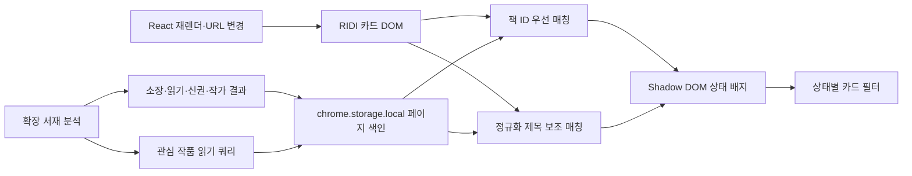

# RIDI 페이지 인핸서 분석

기준 시각은 2026-10-24 20:39 KST다.

## 적용 결론

| 화면 | 현재 경로 | 적용 기능 | 식별 방식 |
|---|---|---|---|
| 구매 목록 | `/library/books` | 소장·신권·미독·완독·관심 배지와 필터 | 표지 제목, 분석 색인 |
| 내 책장 | `/library/shelves`, `/library/shelf/:uuid` | 소장·신권·미독·완독·관심 배지와 필터 | 표지 제목, 분석 색인 |
| 관심 작품 | `/library/serial-preferences` | 관심·새 이야기 배지와 필터 | 관심 GraphQL 색인, 페이지 문맥 |
| 만화 신작 | `/comics/new-releases?tab=CATEGORY_COMIC_ALL` | 소장·미소장·신권·내 작가·관심 배지와 필터 | `/books/{id}` 링크, 정규화 제목 |

전체 페이지를 복제하거나 교체하지 않고 RIDI가 그린 카드에 작은 상태 표시와 필터만 추가하는 구조를 채택했다.

## Steam 확장 선례

2026-10-24에 [SteamDB Browser Extension](https://github.com/SteamDatabase/BrowserExtension/tree/c6c32a6a0a59c1415755beea64821d6a2a620d4d)과 [Augmented Steam](https://github.com/IsThereAnyDeal/AugmentedSteam/tree/25f63f2e3dc1ddfcc26631cb2aee67272a5a8956)을 확인했다.

| 선례 | 확인한 방식 | RIDI 적용 |
|---|---|---|
| SteamDB | [페이지 범위별 content script 분리](https://github.com/SteamDatabase/BrowserExtension/blob/c6c32a6a0a59c1415755beea64821d6a2a620d4d/manifest.json#L100-L169) | 라이브러리와 만화 신작 URL에만 인핸서를 주입 |
| SteamDB | [페이지 준비 전에는 MutationObserver로 대기](https://github.com/SteamDatabase/BrowserExtension/blob/c6c32a6a0a59c1415755beea64821d6a2a620d4d/scripts/steamdb/global.js#L169-L201) | SPA 렌더 뒤 카드가 생기면 다시 수집 |
| Augmented Steam | [위시리스트 기능을 독립 모듈로 조합](https://github.com/IsThereAnyDeal/AugmentedSteam/blob/25f63f2e3dc1ddfcc26631cb2aee67272a5a8956/src/js/Content/Features/Store/Wishlist/CWishlist.ts#L53-L70) | API 색인·DOM 수집·배지·필터 책임을 분리 |
| Augmented Steam | [React 위시리스트 변경을 관찰해 DOM 색인을 갱신](https://github.com/IsThereAnyDeal/AugmentedSteam/blob/25f63f2e3dc1ddfcc26631cb2aee67272a5a8956/src/js/Content/Features/Store/Wishlist/Utils/WishlistDOM.ts#L125-L137) | RIDI React 재렌더와 경로 전환 뒤 배지를 재적용 |

두 확장의 구현은 선례이지 RIDI DOM의 안정성을 보증하지 않는다.

[Chrome content script 공식 문서](https://developer.chrome.com/docs/extensions/develop/concepts/content-scripts)는 격리된 실행 환경에서 페이지 DOM을 읽고 변경하는 방식을 설명하며, [match pattern 문서](https://developer.chrome.com/docs/extensions/develop/concepts/match-patterns)는 주입 URL 범위를 제한하는 기준을 제공한다.

## 현재 RIDI 근거

1. 라이브러리 메인 번들의 빌드 경로는 `library-frontend/p/6daf78`이며 `/books`, `/shelves`, `/shelf/:uuid`, `/serial-preferences` 경로가 포함돼 있다.
2. 관심 작품 청크 `328.7068455b1dd52c5d9d60.js`는 `userInterestBook`, `UserInterestBookOrderFilter`, `newReleaseCount`를 포함한다.
3. 관심 작품 청크의 크기는 41,509바이트이고 SHA-256은 `a4f59c28450dc669f00d5dabf6d36d16d618c359ddcd055923a341153e0b62df`다.
4. 해당 청크의 CDN `Last-Modified`는 2026-10-23 15:08:16 KST였다.
5. 만화 신작 페이지의 한 스냅샷은 539,635바이트였고 `/books/{id}` 링크 120개와 고유 책 ID 60개를 포함했다.
6. 만화 신작 페이지는 기본 익명 cURL에 403을 반환했지만 같은 시각의 일반 Chrome User-Agent 요청에는 HTML을 반환했다.
7. 로그인된 구매 목록의 현재 화면은 표지 접근성 이름이 `표지`로 끝나고 카드마다 원본 메뉴 아이콘이 별도로 존재했다.
8. 현재 서재 링크는 `ridibooks.com/library/...`로 통합됐으며 구형 `library.ridibooks.com/...` 진입도 새 주소로 이동했다.

5번과 7번은 단일 시각의 DOM 관찰이며 RIDI의 공개 계약이 아니다.

6번은 User-Agent에 따른 관찰 차이일 뿐 Cloudflare를 항상 통과한다는 증거가 아니다.

## 처리 흐름

## DOM 변경 원칙

- 표지는 `alt` 또는 `aria-label`이 `표지`로 끝나는 요소만 수집해 원본 메뉴 아이콘 오탐을 줄인다.
- 만화 신작은 같은 책 ID의 표지 링크와 제목 링크가 함께 들어 있는 최소 공통 조상을 카드로 선택한다.
- 책 ID가 있으면 정확히 매칭하고, 없을 때만 권수·판형 표기를 제거한 제목을 보조 키로 사용한다.
- 미독과 완독이 동시에 제목으로 매칭되면 정확한 책 ID 결과를 우선하고, 정확도를 가릴 수 없으면 미독으로 보수적으로 분류한다.
- 카드당 배지는 최대 4개이며 관심 작품에서는 `새 이야기`와 `관심`, 만화 신작에서는 소장·신권 상태를 우선한다.
- 배지와 하단 도구 모음은 Shadow DOM으로 렌더링해 RIDI 스타일과의 충돌을 줄인다.
- 필터는 카드를 삭제하지 않고 확장 전용 클래스로 숨긴다.
- React가 표지 하위 노드만 교체한 경우 기존 카드 마커가 남아 있어도 배지 호스트가 없으면 다시 삽입한다.
- `MutationObserver`, `popstate`, `hashchange`, URL 변경 감시로 SPA 전환을 처리한다.

## 상태 판정 한계

| 위험 | 현재 완화 | 남는 한계 |
|---|---|---|
| 동명 작품 | 책 ID를 우선 사용 | 라이브러리 카드에 책 ID가 없으면 제목 오탐 가능 |
| 판형·권수 표기 차이 | 제목 정규화 | 제목 자체가 바뀌면 누락 가능 |
| RIDI CSS 변경 | 의미 기반 표지 이름과 링크 사용 | 접근성 이름·링크 구조까지 바뀌면 수정 필요 |
| React 재렌더 | DOM 관찰과 배지 존재 재검사 | RIDI가 폐쇄형 Shadow DOM으로 옮기면 접근 불가 |
| 관심 API 실패 | 핵심 서재 분석과 분리 | 관심·새 이야기 배지는 표시되지 않음 |
| 오래된 분석 | 사용자가 재분석 가능 | 구매·관심 변경 직후에는 캐시가 낡을 수 있음 |

## 검증 경계

- 페이지 색인의 150개 초과 결과 보존, 정확 ID·정규화 제목 분류, 관심 새 이야기 분류를 단위 테스트한다.
- 관심 GraphQL의 100개 단위 페이지네이션과 101번째 항목 수집을 모의 응답으로 테스트한다.
- 매니페스트가 라이브러리와 만화 신작에만 인핸서를 주입하고 RIDI 외 호스트 권한이 없는지 테스트한다.
- 만화 신작 정적 HTML 스냅샷에서 60개 고유 카드 복원을 확인했다.
- 2026-10-24 전체 검증에서 Vitest 8개 파일의 108개 테스트, ESLint, TypeScript 무출력 검사와 Next.js 프로덕션 빌드가 통과했다.
- 로그인 세션의 읽기 전용 관심 GraphQL 실호출은 10개 관심 작품을 반환했고, 100개 단위 페이지네이션은 101개 모의 응답으로 별도 검증했다.
- 설치된 확장 분석은 23초에 소장 항목 1,897개, 읽기 판정 대상 1,670개, 상위 작가 40명, 관심 작품 10개를 수집했다.
- 구매 목록은 `전체 48`, `소장 48`, `신권 15`, `미독 27`, `완독 20`이었고 필터 적용과 전체 복원을 확인했다.
- 관심 작품은 `전체 10`, `소장 9`, `미소장 1`, `신권 3`, `미독 5`, `완독 4`, `관심 10`, `새 이야기 4`, `내 작가 1`이었고 `새 이야기` 필터가 4개만 남기는 것을 확인했다.
- 만화 신작은 `전체 60`, `소장 30`, `미소장 30`, `신권 30`, `미독 29`, `완독 1`이었고 `신권` 필터가 30개만 남기는 것을 확인했다.
- 내 책장은 이 계정에 생성된 책장이 없어 `전체 0` 도구 모음과 빈 상태만 확인했으며, 실제 책장 카드 분류는 단위 테스트 범위다.
- `0.3.0` 실검증에서 미독·완독 동시 표시와 배지 우선순위 문제를 발견해 `0.3.1`에서 수정했고, 통합 서재 URL 누락을 `0.3.2`에서 수정한 뒤 네 화면을 다시 확인했다.
